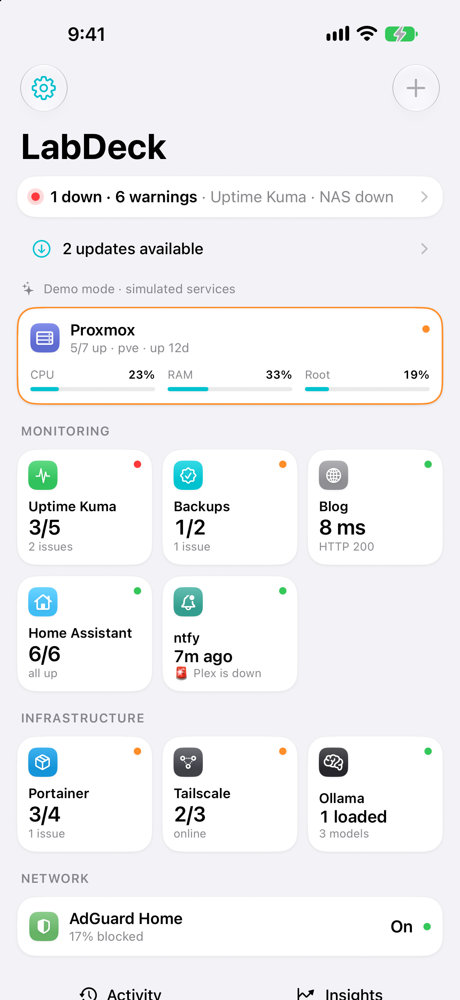
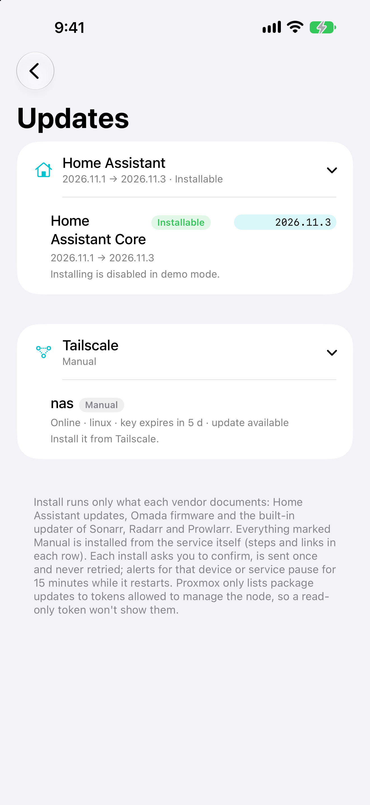
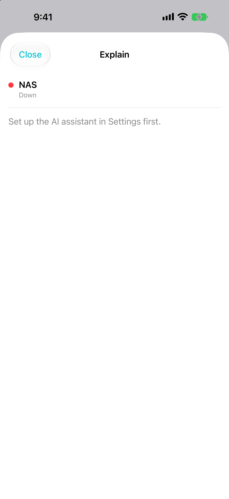
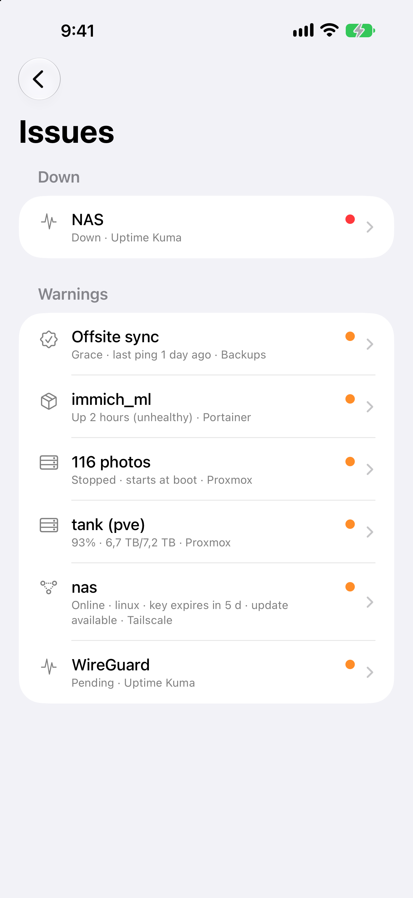
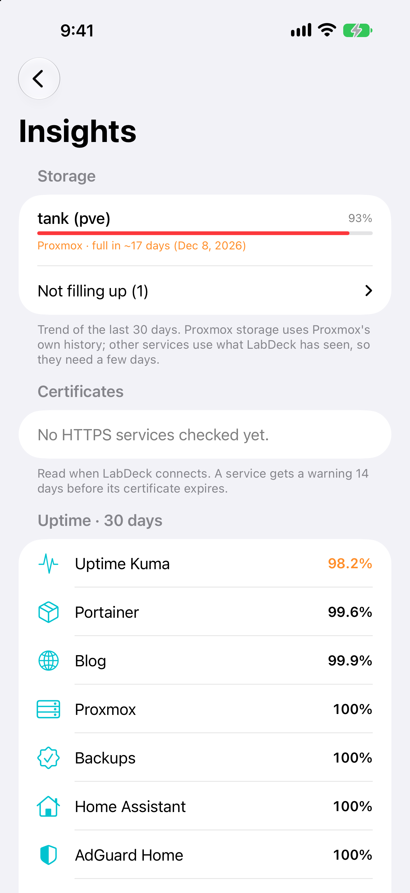
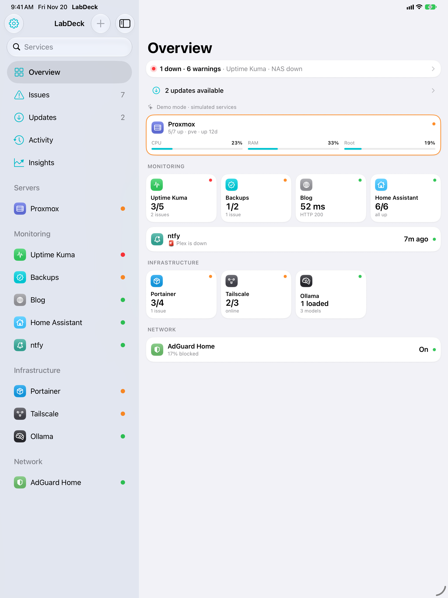
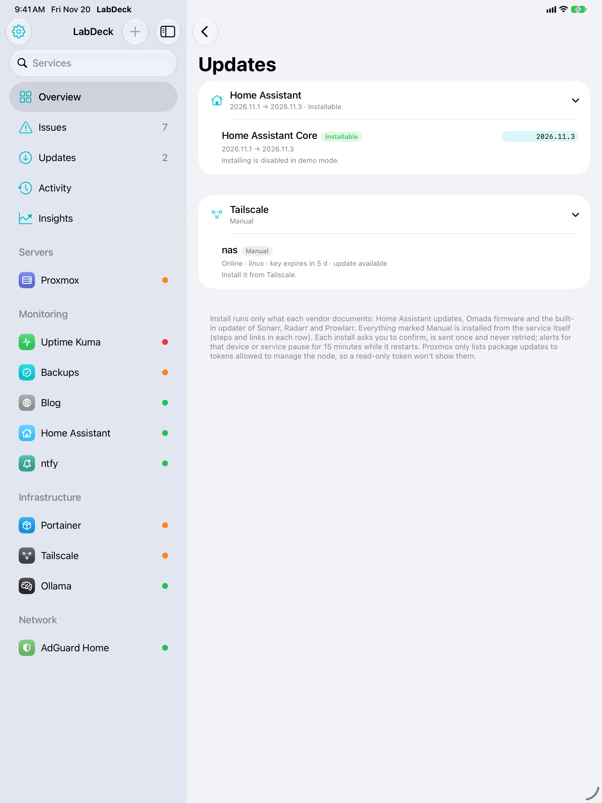

-lightgrey)

# LabDeck

**A home lab dashboard for iPhone and iPad.** It finds your services, tells you what needs attention, installs updates for you, and can explain problems with your own AI. It talks to each service directly: no LabDeck account, no server of ours, no subscription.

**[Download on the App Store](https://apps.apple.com/app/id6836890094)**

> This repository is the **public feedback hub** for LabDeck: bug reports, service requests and ideas. LabDeck is closed source, so there's no app code here.

## What makes LabDeck different

Most homelab apps show you a status page. LabDeck is built to **act**, and to keep everything on your own gear:

| | |
|---|---|
| ⬇️ **Install updates from your phone** | One list of pending updates across your lab; install Home Assistant, TP-Link Omada firmware and Sonarr/Radarr/Prowlarr updates with a tap and a confirmation. |
| 🧠 **Private AI on *your* Ollama** | Ask "what's wrong?" or tap Explain on a problem. It runs on your own Ollama server, with IPs, host names and keys masked first. Nothing goes to any cloud AI. |
| 💻 **Configure from your computer** | Your iPhone serves a temporary page on your LAN (one-time code + Face ID) so you can paste URLs and API keys from your desktop. |
| 🔑 **Setup without copy-paste** | Network scan across VLANs, read-only API keys created from inside the app (Proxmox, Uptime Kuma, Healthchecks), and import from Homepage/Homarr configs. |
| 🏠 **Home ↔ away, automatically** | Local address at home, Tailscale (or any second address) when you're out. Self-signed certificates pinned per service. |
| 🧩 **One app for the whole lab** | Proxmox VE/PBS, Home Assistant, Omada, UniFi, OPNsense, AdGuard, Tailscale, Ollama, the *arr stack and more, side by side. |
| 🔒 **No account, no server, no subscription** | It talks straight to your services. Free for 3 services; Pro is a one-time US$4.99. |

## Screenshots

  
  
  
  
  

  
  

Screenshots use the built-in demo mode with sample data.

## What it does

- **Install updates from your phone.** One list of pending updates from every service. Install right there, after a confirmation, for Home Assistant update entities, TP-Link Omada devices and Sonarr/Radarr/Prowlarr (built-in updater, not Docker installs). For everything else LabDeck shows what's waiting and where to update it.
- **Ask your own AI, privately.** Connect your own Ollama server, then ask "what's wrong?" or tap Explain on any problem. Addresses, host names, emails and keys are masked before anything is sent, and it only goes to your server. Off until you turn it on.
- **Set up from your computer.** "Configure from your computer" opens a temporary page served by your iPhone on your own network, protected by a one-time code and Face ID. Nothing goes through the internet.
- **Less copy-paste.** Scan your network, including other subnets and VLANs you can reach (LabDeck tells you when a subnet isn't routed). Create a read-only API key from inside the app for Uptime Kuma, Proxmox and Healthchecks. Import from a Homepage or Homarr config, or from plain text.
- **Home or away.** Give a service a second address, such as Tailscale. LabDeck uses the local one when it answers and the remote one when you're out. Self-signed certificates are pinned per service.
- **Know what needs attention.** Problems first; silence an item for an hour, a day or for good. Activity and Insights for trends. Local alerts, plus messages from your own ntfy or Gotify.
- **Always within reach.** Widgets for the Home Screen, Lock Screen and StandBy; Live Activities; Siri and Shortcuts (power actions confirmed with Face ID); iPhone and iPad synced through your own iCloud.
- English and Spanish. Demo mode with sample data if you just want to look around.

## Supported services

| Area | Services |
|---|---|
| Virtualization & storage | Proxmox VE, Proxmox Backup Server, TrueNAS, Unraid, Portainer, Scrutiny |
| Home & network | Home Assistant, TP-Link Omada, UniFi Network, OPNsense, pfSense, AdGuard Home, Pi-hole, Tailscale, NUT (UPS), Speedtest Tracker |
| Monitoring & alerts | Uptime Kuma, Healthchecks, ntfy, Gotify, HTTP checks, custom JSON endpoints |
| Apps & backups | Immich, Paperless-ngx, Nextcloud, Duplicati, Backrest, Ollama |
| Media module (optional) | Sonarr, Radarr, Prowlarr, Bazarr, Tdarr, qBittorrent, SABnzbd, Plex, Jellyfin, Tautulli, Overseerr, Jellyseerr |

Missing something? [Request a service](../../issues/new?template=service_request.yml).

## Free and Pro

| | Free | LabDeck Pro |
|---|---|---|
| Services | Up to 3 (demo services don't count) | Unlimited |
| Widgets (Home Screen, Lock Screen, StandBy) | ✓ | ✓ |
| Siri & Shortcuts | ✓ | ✓ |
| Network scan, import & export, iCloud sync | ✓ | ✓ |
| Alerts, ntfy & Gotify | ✓ | ✓ |
| Activity & Insights history | Last 24 hours | Beyond 24 hours |
| Live Activities | | ✓ |
| Local AI assistant (your own Ollama) | | ✓ |
| Configure from your computer | | ✓ |

**LabDeck Pro is US$4.99, one time.** No subscription, shared with your family through Family Sharing. Going over 3 services never hides or deletes the ones you have; you just can't add more without Pro.

## Privacy

- No accounts, no analytics, no tracking, no ads, no servers of ours. We don't receive your data.
- The app connects to the services you add. Third-party APIs are contacted only if you add them yourself (e.g. Tailscale, Healthchecks.io). The optional Media module loads posters from TMDB when you search Overseerr/Jellyseerr.
- Credentials live in your Keychain and can sync through iCloud Keychain (end-to-end encrypted); you can turn that off.
- The AI assistant only talks to your own Ollama server, with sensitive details masked first.
- Full policy: https://smides.cl/labdeck/privacidad

## Reporting a bug

1. In LabDeck, open **Settings > Diagnostics**. Optionally pick the affected service.
2. Tap **⋯ > Share** (or Copy). The log lists each connection's method, path, HTTP status, redirects, TLS and timing. It has **no keys, tokens, cookies, header values or query values**.
3. **Read it before posting.** It includes the names you gave your services and, for redirects, the address it was redirected to. Edit out anything you don't want public, or email it instead.
4. [Open a bug report](../../issues/new?template=bug_report.yml) and paste it in.

Prefer email? labdeck@smides.cl. Security issue? Email, don't open a public issue.

## About

- **Closed source.** It's a one-person project, kept sustainable by a one-time purchase. I may open parts later, but no promises. This repo is the public place for bugs, service requests and ideas.
- **Platforms.** iPhone/iPad only for now (it also runs on Apple silicon Macs as an iPad app); if there's demand, maybe later.
- **Siri power actions.** Reboot, shut down and start need a Proxmox token with power rights. The token LabDeck creates is read-only; the first time Proxmox refuses, tap "Allow power actions" and sign in once with an admin account to add a minimal role (VM.PowerMgmt + VM.Audit on /vms).
- **How it's built.** Built by me with heavy help from AI coding tools (Claude); I designed it, tested it and run it on my own lab every day.

## Help me cover your lab

I read every request and add missing services as fast as I can. The goal is one app for the whole lab, and I can't test every piece of gear myself, so if your service isn't there or something breaks, [open a request](../../issues/new/choose) and I'll work on it. If you can test a TestFlight build against your own setup, say so in the request.

**Beta testers welcome:** new services and fixes land on TestFlight first. Join here: **[testflight.apple.com/join/4vK4wrtx](https://testflight.apple.com/join/4vK4wrtx)** (limited spots; Pro features are unlocked in beta).

## Links

- App Store: https://apps.apple.com/app/id6836890094
- Support: https://smides.cl/labdeck/soporte
- Privacy policy: https://smides.cl/labdeck/privacidad
- Email: labdeck@smides.cl
- [Roadmap](ROADMAP.md) (ideas, not promises)
- [Discussions](../../discussions) for questions and show-and-tell

LabDeck is an independent app and is not affiliated with any of the products it connects to.
